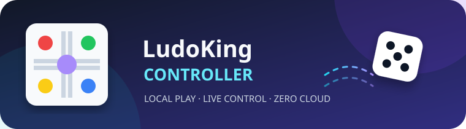
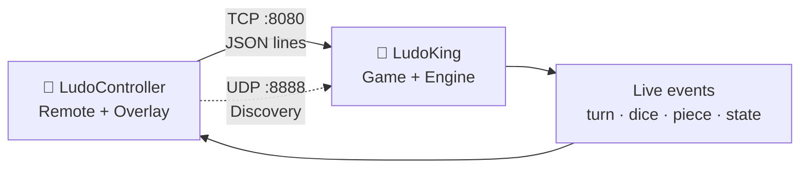

<div align="center">



# LudoKing Controller

### A local-first Android Ludo game with a live remote controller and floating HUD

<p>
  <a href="https://github.com/DiwasKhatri07/LudoKing-Controller/actions/workflows/android.yml"></a>
  <a href="https://github.com/DiwasKhatri07/LudoKing-Controller/blob/main/LICENSE"></a>
  <a href="https://github.com/DiwasKhatri07/LudoKing-Controller/releases"></a>
  <a href="https://github.com/DiwasKhatri07/LudoKing-Controller/stargazers"></a>
  <a href="https://developer.android.com/"></a>
  
</p>

<p><strong>Play the game. Pair locally. Control every move.</strong></p>

<p>
  <a href="#-quick-start">Quick start</a> ·
  <a href="#-features">Features</a> ·
  <a href="#-architecture">Architecture</a> ·
  <a href="#-build-from-source">Build</a> ·
  <a href="#-contributing">Contributing</a>
</p>

</div>

---

## What is this?

**LudoKing Controller** is a two-app Android project:

- **LudoKing** — the offline board game, game engine and local TCP server.
- **LudoController** — a companion remote with auto-discovery, dice controls, move selection and an optional floating overlay.

The apps communicate on the same phone or local Wi-Fi network. There is no cloud server, account requirement, analytics SDK or advertising layer in the controller architecture.

> **Note:** This project is an independent open-source Android project and is not affiliated with the commercial product “Ludo King”.

## ✨ Features

### Game app

- Offline pass-and-play and computer-player flows.
- Native board rendering, dice and piece animations.
- Local TCP server on port `8080`.
- Pairing support with a PIN/session token.
- Local game-state events for the companion controller.

### Controller app

- Auto-discover a game on the local network using UDP broadcast (`8888`).
- Manual host, port and PIN connection when discovery is unavailable.
- Dice controls (`1`–`6`) and fair-roll action.
- Piece selection and game-flow controls.
- Live protocol/event log for debugging.
- Optional floating overlay for one-phone play.

## 🧭 Quick start

### Use two phones on the same Wi-Fi

1. Install the **LudoKing** APK on the game phone and **LudoController** on the controller phone.
2. Open LudoKing and enable **Controller Mode**.
3. Start the game and keep the displayed IP/PIN available.
4. Open LudoController and tap **AUTO CONNECT**.
5. If discovery is blocked by the router, enter the game phone's local IP, port `8080` and PIN manually.

### Use one phone

1. Install both apps on the same phone.
2. Grant the controller's **draw over other apps** permission.
3. Start the floating overlay from LudoController.
4. Open LudoKing and use the overlay controls while playing.

> Both devices must be on the same local network. Public internet is not required. Never expose port `8080` to the public internet.

## 🧱 Architecture



```text
.
├── app/                    # LudoKing game APK
│   └── src/main/java/      # engine, network, protocol and activities
├── controller-app/         # LudoController companion APK
│   └── src/main/java/      # client, discovery, overlay and UI
├── assets/                 # README branding assets
├── .github/                # CI, metrics and community health files
├── build.gradle            # shared Android build configuration
└── settings.gradle         # project modules
```

## 🔌 Protocol at a glance

The controller and game exchange **UTF-8, newline-delimited JSON** over a local TCP socket. Pair first, then send commands with the session token.

```json
{"command":"PAIR_REQUEST","pin":"4829"}
{"event":"PAIR_ACCEPTED","token":"session-token"}
{"command":"ROLL_DICE","token":"session-token","value":6}
{"event":"DICE_ROLLED","dice":6,"turn":"RED"}
```

The protocol implementation lives in `app/.../protocol` and is shared conceptually by the controller client. See the source for the current command/event names before building third-party integrations.

## 🛠️ Build from source

### Requirements

- Android Studio with an Android SDK platform/build tools that support `compileSdk 33`.
- JDK 8 or newer.
- A device/emulator running Android 5.0 (API 21) or newer.

```bash
git clone https://github.com/DiwasKhatri07/LudoKing-Controller.git
cd LudoKing-Controller

# Make the wrapper executable if your checkout did not preserve the bit
chmod +x gradlew

# Build both debug APKs
./gradlew assembleDebug

# Optional: build release artifacts
./gradlew assembleRelease
```

Outputs are written to:

- `app/build/outputs/apk/`
- `controller-app/build/outputs/apk/`

### Release signing

Release signing is intentionally **not** committed. Copy `signing.properties.example` to `signing.properties` and fill it locally, or provide the equivalent `LUDO_*` environment variables. The keystore and credentials are ignored by Git.

## 🧪 Quality checks

Every pull request and push to `main` runs the Android build workflow. The scheduled metrics workflow refreshes [`.github/metrics.md`](.github/metrics.md) approximately every 40 minutes and commits only that generated file.

> GitHub's cron scheduler expresses this as `*/40 * * * *` (minute 0 and 40 of each hour; it cannot represent a perfectly uniform 40-minute interval across hour boundaries).

## 📦 Releases

Stable APKs, checksums and release notes belong in [GitHub Releases](https://github.com/DiwasKhatri07/LudoKing-Controller/releases). Do not commit generated APKs or private signing material to this repository.

## 🤝 Contributing

Ideas, bug reports and pull requests are welcome. Please read:

- [CONTRIBUTING.md](CONTRIBUTING.md) — development and PR checklist
- [CODE_OF_CONDUCT.md](CODE_OF_CONDUCT.md) — community expectations
- [SECURITY.md](SECURITY.md) — responsible vulnerability reporting

For bugs, include the Android version, device model, app version, reproduction steps and relevant log output. Do not post pairing tokens, private IPs or credentials in public issues.

## 👨‍💻 Maintainer

Created and maintained by **[Diwas Khatri](https://github.com/DiwasKhatri07)**.

- Email: [diwaskhatri@proton.me](mailto:diwaskhatri@proton.me)
- Repository: [github.com/DiwasKhatri07/LudoKing-Controller](https://github.com/DiwasKhatri07/LudoKing-Controller)

## 📄 License

Released under the [MIT License](LICENSE).

<div align="center">

**If this project helps you, consider leaving a ⭐ on GitHub.**

</div>
